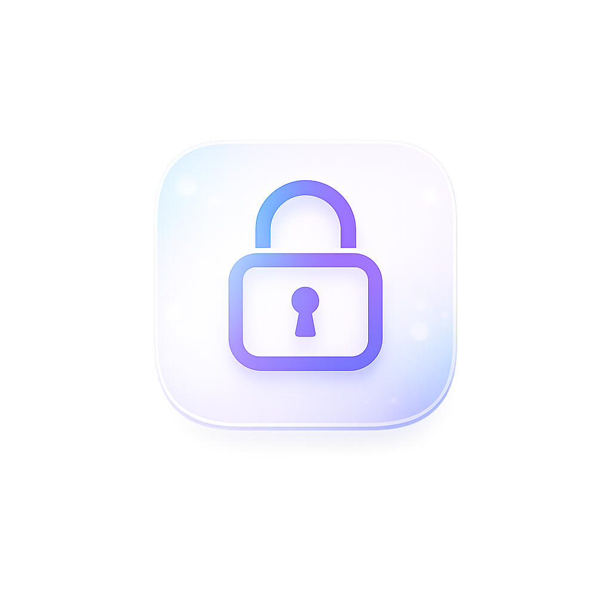
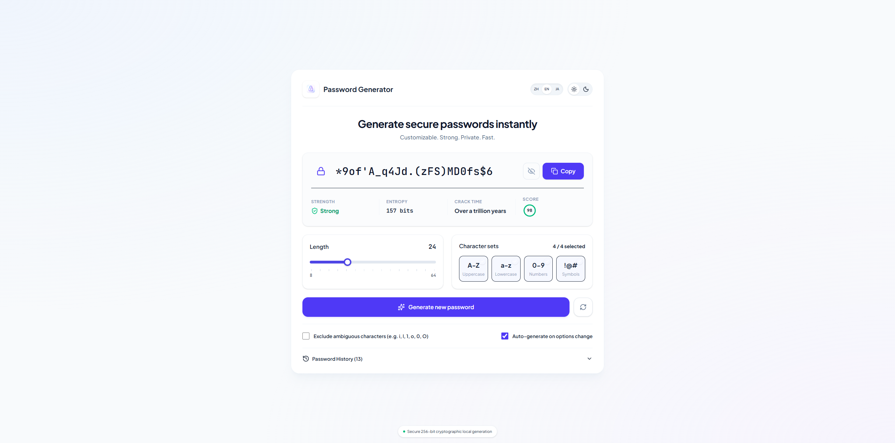

<div align="center">
  
  <h1>KeyForge</h1>
  <p><strong>Modern Cryptographic Password, Passphrase & PIN Studio</strong></p>

  <p>
    <strong>English</strong> · <a href="./README.zh-CN.md">简体中文</a>
  </p>

  <p>
    
    
    
    
    
    
  </p>
</div>

---

## 📸 Preview

<div align="center">
  
</div>

---

## ✨ Features

### 1. Multi-Mode Generation
- **🔑 Random Password**
  - Adjustable length from `8` to `64` characters (defaults to `30`), equipped with `- / +` fine-tuning steppers and quick preset pills (`8 / 12 / 16 / 24 / 30 / 48 / 64`).
  - Independent character set cards for Uppercase (`A-Z`), Lowercase (`a-z`), Numbers (`0-9`), and Symbols (`!@#`).
  - Toggle switch to exclude ambiguous characters (`i, l, 1, L, o, 0, O`).
- **📖 Memorable Passphrase**
  - Built-in curated EFF-inspired word list supporting `3–8` word combinations.
  - Customizable separators (Hyphen `-`, Dot `.`, Underscore `_`, Space ` `), word capitalization, and optional random number suffix.
- **🔢 PIN Code**
  - Generates `4–12` digit numeric PINs with quick length presets.
  - Optional filter to avoid sequential digits (e.g., `1234`) and adjacent repeating digits (e.g., `1111`).

### 2. Unbiased Cryptographic Security (CSPRNG)
- **Rejection Sampling**: Powered by the browser's native `window.crypto.getRandomValues` with rejection sampling to eliminate traditional modulo bias (`rand % length`).
- **Guaranteed Character Set Inclusion**: Uses a cryptographically secure **Fisher-Yates shuffle** to ensure every selected character set is included at least once at uniformly random positions.
- **100% Client-Side Privacy**: All generation, strength evaluation, and history storage occur strictly locally in your browser with zero network transmission.

### 3. Real-Time Security Anatomy & Custom Password Tester
- **Color-Coded Syntax Highlighting**: Distinct visual colors for **Letters**, **Numbers (Indigo)**, and **Symbols (Emerald)** for effortless verification.
- **Four-Dimensional Metrics**:
  - **Strength Badge**: Dynamic 5-tier rating (*Very Weak / Weak / Medium / Strong / Very Strong*).
  - **Entropy Calculator**: Real-time effective entropy computation in `bits`.
  - **Crack Time Estimator**: Brute-force time estimation assuming $10^{11}$ (100 Billion) guesses per second.
  - **Circular Score Ring (`0–100`)**: Animated SVG vector progress ring.
- **Password Anatomy Sidebar**: Multi-segment character distribution bar, character type counters, and contextual security recommendations.
- **Custom Password Test Mode**: Click the edit button (`PenLine`) to type or paste any custom password and inspect its security metrics in real time (press `ESC` or `Enter` to exit).

### 4. Adaptive Responsive Design & UX
- **Wide Desktop Monitors (`1080p / 2K / 4K`)**: Expansive `max-w-[1760px]` 12-column workspace pairing the primary generator on the left with a live Security Anatomy & Password History sidebar on the right.
- **Mobile & Tablet Ready**: Seamlessly adapts into a touch-friendly single-column layout with a collapsible history drawer.
- **Local History Management**: Stores up to 20 generated or copied passwords in `localStorage` with masked preview, individual reveal/copy/delete, and one-click clear.
- **Multi-Language & Theme System**: Built-in **English (`EN`, default)**, **Simplified Chinese (`ZH`)**, and **Japanese (`JA`)** instant switching, plus Light and Dark mode persistence.

---

## ⌨️ Keyboard Shortcuts

When not focused inside a text input, the following global desktop shortcuts are available:

| Key | Action |
| :---: | :--- |
| <kbd>R</kbd> | Regenerate a new password immediately |
| <kbd>C</kbd> | Copy the current password to clipboard |
| <kbd>ESC</kbd> / <kbd>Enter</kbd> | Exit custom password test/edit mode |

---

## 📂 Project Structure

```text
KeyForge/
├── public/
│   ├── favicon.svg              # Vector site favicon
│   ├── logo.png                 # Brand logo
│   └── screencapture.png        # UI preview screenshot
├── src/
│   ├── components/
│   │   ├── Header.tsx           # Brand header, language switcher & theme toggle
│   │   ├── PasswordDisplay.tsx  # Color-coded display, custom test input & 4D metrics
│   │   ├── GeneratorControls.tsx# Mode tabs, sliders, preset pills & toggle switches
│   │   └── SecuritySidebar.tsx  # Character distribution bar & local history panel
│   ├── i18n/
│   │   └── translations.ts      # EN / ZH / JA translation dictionaries
│   ├── types/
│   │   └── password.ts          # Core TypeScript interfaces
│   ├── utils/
│   │   └── password.ts          # Web Crypto rejection-sampling generator & entropy engine
│   ├── App.tsx                  # Main workspace state, keyboard shortcuts & responsive grid
│   ├── main.tsx                 # React root entry point
│   └── style.css                # Tailwind CSS v4 theme & range slider styling
├── index.html
├── package.json
├── tsconfig.json
└── vite.config.ts
```

---

## 🚀 Getting Started

### Prerequisites
- **Node.js** `>= 18.0.0` (`v20` or `v22` recommended)

### Installation & Development

```bash
# 1. Clone the repository
git clone https://github.com/JackieSung4ev/KeyForge.git
cd KeyForge

# 2. Install dependencies
npm install

# 3. Start local development server
npm run dev

# 4. Type-check and build for production
npm run build

# 5. Preview production build locally
npm run preview
```

---

## ☁️ Deploying to Cloudflare Pages

KeyForge is a pure static frontend application and can be hosted for free on **Cloudflare Pages**:

1. Log in to the [Cloudflare Dashboard](https://dash.cloudflare.com/) and navigate to **Workers & Pages** → **Create** → **Pages** → **Connect to Git**.
2. Select the `JackieSung4ev/KeyForge` repository.
3. Configure the build settings:
   - **Production branch**: `main`
   - **Framework preset**: `Vite`
   - **Build command**: `npm run build`
   - **Build output directory**: `dist`
4. Click **Save and Deploy**.

---

## 📄 License

MIT License © [JackieSung4ev](https://github.com/JackieSung4ev)
