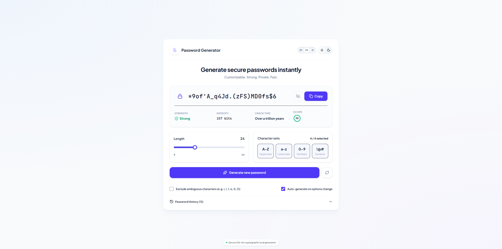

<div align="center">
  
  <h1>KeyForge</h1>
  <p><strong>一款现代、轻量、100% 浏览器本地加密的安全密码与助记词生成工坊</strong></p>

  <p>
    <a href="./README.md">English</a> · <strong>简体中文</strong>
  </p>

  <p>
    
    
    
    
    
    
  </p>
</div>

---

## 📸 界面预览

<div align="center">
  
</div>

---

## ✨ 核心特性

### 1. 三大生成模式
- **🔑 随机密码 (Random Password)**
  - 支持 `8–64` 位长度自由调节（默认 `30` 位），配备 `- / +` 微调步进器与快捷长度预设胶囊（`8 / 12 / 16 / 24 / 30 / 48 / 64`）。
  - 支持四类字符集（大写 `A-Z`、小写 `a-z`、数字 `0-9`、特殊符号 `!@#`）独立开关。
  - 支持 Toggle 开关一键排除易混淆字符（`i, l, 1, L, o, 0, O`）。
- **📖 易记词组 (Memorable Passphrase)**
  - 内置精选易拼写词库，支持 `3–8` 个单词组合。
  - 支持自定义分隔符（连字符 `-`、句点 `.`、下划线 `_`、空格 ` `）、单词首字母大写及末尾附加随机数字。
- **🔢 PIN 码 (PIN Code)**
  - 支持 `4–12` 位纯数字 PIN 生成及快捷位数选择。
  - 支持自动过滤连续数字（如 `1234`）与相邻重复数字（如 `1111`）。

### 2. 加密级随机与零偏差算法 (Unbiased CSPRNG)
- **拒绝采样（Rejection Sampling）**：基于浏览器原生 `window.crypto.getRandomValues` 实现无偏随机数生成，彻底消除传统取模运算（`rand % length`）带来的分布偏差。
- **必选字符集保障与均匀洗牌**：采用加密级 **Fisher-Yates 洗牌算法**，确保每一个勾选的字符集至少包含一个字符，且在密码任意位置均匀随机分布。
- **100% 本地隐私安全**：所有生成、检测与历史记录均在本地浏览器完成，零网络请求、零数据上传。

### 3. 实时安全剖析与自定义密码检测
- **色彩语法高亮**：对密码中的**字母**、**数字（靛蓝）**、**符号（翠绿）**进行视觉色彩区分，一眼识别字符类型。
- **四维安全指标**：
  - **安全强度徽标**：极弱 / 较弱 / 中等 / 安全 / 极高安全五级动态评估。
  - **信息熵计算（Entropy）**：实时计算密码有效比特熵（`bits`）。
  - **暴力破解估时**：基于每秒 1,000 亿次（$10^{11}\text{ guesses/s}$）现代算力估算破解耗时。
  - **环形安全评分（0–100）**：SVG 动态进度环直观呈现综合得分。
- **密码结构剖析面板**：可视化展示各字符集占比进度条、字符统计及针对性安全建议。
- **手动输入/检测模式**：点击展示框右侧的编辑按钮，即可直接输入或粘贴任意密码，实时测试其安全强度（支持按 `ESC` 或 `Enter` 快速退出编辑）。

### 4. 全端自适应与交互体验
- **大屏桌面端（1080p / 2K / 4K）**：采用 `max-w-[1760px]` 宽屏双栏工作台布局，左侧为主生成器与安全指标，右侧常驻结构剖析与历史记录面板。
- **移动端与平板适配**：自动收敛为单列触控友好布局，历史记录智能折叠为抽屉面板。
- **本地历史记录**：自动保存最近 20 条生成或复制的密码至 `localStorage`，支持单条掩码显示/隐藏、一键复制、单条删除与全部清空。
- **多语言与主题切换**：内置 **English (`EN`，默认)**、**简体中文 (`ZH`)**、**日本語 (`JA`)** 三语无缝切换，支持浅色（Light）/ 深色（Dark）主题记忆。

---

## ⌨️ 快捷键

在非输入框聚焦状态下，支持以下桌面端全局快捷键：

| 按键 | 功能说明 |
| :---: | :--- |
| <kbd>R</kbd> | 立即重新生成新密码 |
| <kbd>C</kbd> | 一键复制当前密码到剪贴板 |
| <kbd>ESC</kbd> / <kbd>Enter</kbd> | 在手动输入/测试密码模式下退出编辑状态 |

---

## 📂 项目结构

```text
KeyForge/
├── public/
│   ├── favicon.svg              # 站点矢量图标
│   ├── logo.png                 # 品牌 Logo
│   └── screencapture.png        # 界面预览截图
├── src/
│   ├── components/
│   │   ├── Header.tsx           # 顶部品牌栏、多语言切换与明暗主题开关
│   │   ├── PasswordDisplay.tsx  # 彩色密码展示框、手动检测模式与四维安全指标
│   │   ├── GeneratorControls.tsx# 三大模式切换、滑块/预设胶囊与 Toggle 开关组
│   │   └── SecuritySidebar.tsx  # 密码结构剖析进度条与本地历史记录管理
│   ├── i18n/
│   │   └── translations.ts      # 英 / 中 / 日三语字典与翻译函数
│   ├── types/
│   │   └── password.ts          # 核心数据结构与类型定义
│   ├── utils/
│   │   └── password.ts          # Web Crypto 拒绝采样生成引擎与信息熵计算器
│   ├── App.tsx                  # 主应用状态管理、快捷键监听与响应式工作台布局
│   ├── main.tsx                 # React 挂载入口
│   └── style.css                # Tailwind CSS v4 主题配置与自定义滑块样式
├── index.html
├── package.json
├── tsconfig.json
└── vite.config.ts
```

---

## 🚀 快速开始

### 环境要求
- **Node.js** `>= 18.0.0`（推荐 `v20` / `v22`）

### 安装与运行

```bash
# 1. 克隆仓库
git clone https://github.com/JackieSung4ev/KeyForge.git
cd KeyForge

# 2. 安装依赖
npm install

# 3. 启动本地开发服务器
npm run dev

# 4. 类型检查与生产环境打包
npm run build

# 5. 本地预览生产构建产物
npm run preview
```

---

## ☁️ 部署到 Cloudflare Pages

本项目为纯静态前端应用，可直接通过 **Cloudflare Pages** 免费托管：

1. 登录 [Cloudflare Dashboard](https://dash.cloudflare.com/)，进入 **Workers & Pages** → **Create** → **Pages** → **Connect to Git**。
2. 选择 `JackieSung4ev/KeyForge` 仓库。
3. 构建参数设置：
   - **Production branch**: `main`
   - **Framework preset**: `Vite`
   - **Build command**: `npm run build`
   - **Build output directory**: `dist`
4. 点击 **Save and Deploy** 即可完成自动化部署。

---

## 📄 License

MIT License © [JackieSung4ev](https://github.com/JackieSung4ev)
